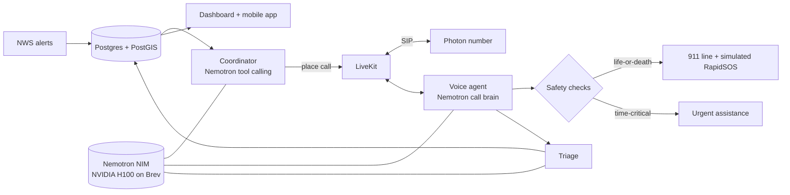

# SF-BEACON

**AI disaster check-in calls, at scale.** When a severe-weather alert hits, SF-BEACON finds every policyholder inside the
alert area, ranks who is most at risk, and **calls them** with a calm, human-sounding voice agent powered by
**NVIDIA Nemotron** — so no one is overlooked on the worst day.

> Built in 24 hours at **HackUTD 2026** for the State Farm, NVIDIA and Photon tracks.

## What it does
- 🌩️ **Live alerts** — pulls National Weather Service alerts and finds every policyholder inside the area (PostGIS).
- 🧭 **Coordinator agent** — Nemotron with real tool calling decides who to call first (medical needs, mobility, age, live flood risk).
- 📞 **Real phone calls** — Photon number ⇄ LiveKit, with **Nemotron as the live brain of every call** (~0.4 s per reply).
- 🚨 **Life-or-death in milliseconds** — immediate danger gets *"Please hang up and call 911 now"* + a simulated RapidSOS handoff for human review.
- 🟠 **Urgent help, not 911** — time-critical needs (oxygen battery running low, missed dialysis) go to a responder queue.
- 🧠 **ML double-check** — a PyTorch Lightning classifier on Nemotron embeddings reviews every caller turn.
- 📊 **Responder dashboard + mobile app** — live map, agent reasoning feed, review queues, transcripts; policyholders can check in from the app.

## How it works


## Results
| | |
|---|---|
| Life-threat judgment (23 caller lines × 3 runs) | **100 %** — every threat caught, no false alarms |
| Realistic simulated clients | **14 / 14** handled correctly |
| ML classifier (held-out / unseen hand-written lines) | **91 % / 96 %**, life-threat recall 95 % |
| Load test on our H100 | 444 Nemotron requests, **0 rate-limit errors** |

**Safety is enforced in code:** the three safety questions always come first, 911 only for life-or-death, never promises
help or insurance coverage, and calls continue on vetted questions if the model is down.

## Tech stack
NVIDIA Nemotron 3.5 (NIM on a Brev H100) · Nemotron Embed · PyTorch Lightning · Photon · LiveKit · Node + TypeScript ·
Postgres + PostGIS · React + Leaflet · Expo · GitHub Actions

## Run it
```bash
brew install postgresql@17 postgis && brew services start postgresql@17
npm install && cp .env.example .env     # add your NVIDIA, LiveKit and Photon keys
npm run db:setup                        # database + 1,500-person demo
npm run dev                             # API → http://localhost:3000
npm run web:install && npm run web      # dashboard → http://localhost:5173  (?mock=1 works without a backend)
npm run agent                           # voice agent for real calls
```
Tests: `npm test` · More: [API](docs/api.md) · [Voice setup](docs/voice-setup.md) · [Demo runbook](docs/demo-runbook.md) · [ML pipeline](ml/README.md)

## Team
[@zoomshields16](https://github.com/zoomshields16) · [@peytonmce](https://github.com/peytonmce) · [MIT License](LICENSE)

*Hackathon prototype. 911 and RapidSOS are simulated — nothing contacts real emergency services. Not affiliated with
State Farm, NVIDIA, Photon or LiveKit.*
